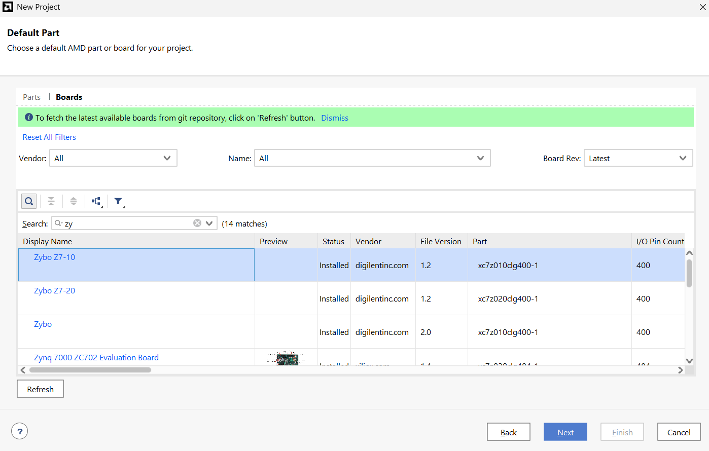
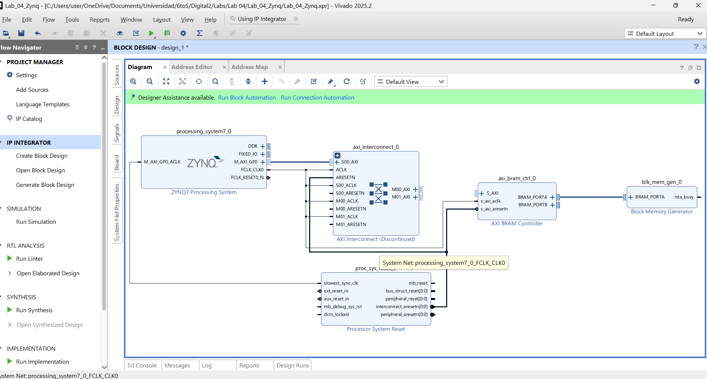

# Laboratorio 04: SoC Zynq-7000

- **Asignatura:** Electrónica Digital II
- **Semestre:** 2026-2

## Integrantes del equipo

- **Samuel Hincapie Perilla**
- **Eduardo Felipe Camacho Lara**
- **Gabriel Alberto Rodríguez Rincón**

---

## Contenido

1. [Objetivo](#1-objetivo)
2. [Arquitectura del Zynq-7000](#2-arquitectura-del-zynq-7000)
3. [Diseño del SoC en Vivado](#3-diseño-del-soc-en-vivado)
4. [Desarrollo del software en Vitis](#4-desarrollo-del-software-en-vitis)
5. [Funcionamiento en la FPGA](#5-funcionamiento-en-la-fpga)
6. [Conclusiones](#6-conclusiones)
7. [Referencias](#7-referencias)

---

## 1. Objetivo

Implementar y verificar el funcionamiento de un sistema embebido basado en la arquitectura Zynq-7000, utilizando la tarjeta de desarrollo Zybo Z7-10. Para ello, se busca integrar el sistema de procesamiento ARM con los periféricos de la lógica programable mediante el protocolo AXI, permitiendo controlar cuatro LEDs y leer cuatro entradas digitales a través de una aplicación desarrollada en lenguaje C utilizando Vitis.

Adicionalmente, se pretende comprender el proceso de diseño de hardware en Vivado, la asignación de direcciones de memoria a los periféricos, la generación del archivo de configuración de la FPGA y la integración entre hardware y software.

El flujo completo de la práctica es:

```
Diseño de hardware (Vivado) → Bitstream → Exportación (.xsa) → Plataforma y aplicación (Vitis) → Ejecución en la FPGA
```

---

## 2. Arquitectura del Zynq-7000

El Zynq-7000 integra en un mismo chip dos partes que trabajan juntas:

| Parte | Contenido | Cómo se programa |
|---|---|---|
| **PS** (*Processing System*) | Procesador ARM Cortex-A9, cachés L1 y L2, controlador de memoria DDR, periféricos (UART, USB, Ethernet, SPI, I2C, CAN, GPIO), temporizadores, DMA y JTAG | Software (C en Vitis) |
| **PL** (*Programmable Logic*) | Lógica reconfigurable Serie 7: LUTs, flip-flops, bloques DSP, BRAM y ruteo programable | Hardware (Block Design o HDL en Vivado) |

Las dos partes se comunican mediante buses **AXI**. En esta práctica, el procesador (PS) actúa como **maestro**: lee y escribe en periféricos implementados en la PL (memoria BRAM y GPIO) como si fueran posiciones de memoria.



---

## 3. Diseño del SoC en Vivado

### 3.1 Instalación de los archivos de la tarjeta

Se instalaron los *board files* de Digilent siguiendo la guía oficial, para que Vivado reconozca la **Zybo Z7-10** como placa. Esto permite que Vivado conozca la configuración del PS (memoria DDR, relojes, pines MIO) y los periféricos de la tarjeta (LEDs y switch), y los configure automáticamente.

### 3.2 Creación del proyecto

Se creó un proyecto RTL seleccionando la placa **Zybo Z7-10** en la pestaña `Boards`, en lugar de elegir solo el chip.


### 3.3 Bloques del sistema

En `IP INTEGRATOR → Create Block Design` se agregaron los siguientes bloques:

| Bloque | Función en el sistema |
|---|---|
| **ZYNQ7 Processing System** | Representa el PS: el procesador ARM y sus periféricos. Entrega a la PL el reloj (`FCLK_CLK0`), la señal de reset (`FCLK_RESET0_N`) y el puerto maestro AXI (`M_AXI_GP0`) por el que el procesador accede a los periféricos de la PL |
| **Processor System Reset** | Toma el reset del PS y lo sincroniza con el reloj. Genera los resets para el interconector (`interconnect_aresetn`) y para los periféricos (`peripheral_aresetn`), de modo que todos salgan de reset de forma ordenada |
| **AXI Interconnect** | Conecta un maestro (el procesador) con varios esclavos (controlador de BRAM y GPIO). Según la dirección de cada acceso, dirige la transacción al periférico correspondiente |
| **AXI BRAM Controller** | Traduce las transacciones AXI del procesador en las señales de dirección, dato y habilitación que necesita la memoria BRAM |
| **Block Memory Generator** | La memoria BRAM implementada en la PL |
| **AXI GPIO** | Periférico de entradas y salidas de propósito general, con un canal para los 4 LEDs y otro para los 4 switch de la tarjeta |

La integración de estos bloques permite construir una arquitectura en la que el procesador ARM actúa como coordinador de las transacciones AXI, mientras que los periféricos implementados en la lógica programable responden a las operaciones de lectura y escritura. El AXI Interconnect permite distribuir las transacciones hacia el controlador de memoria BRAM y el periférico AXI GPIO, según la dirección solicitada.

Para el control de las entradas y salidas se configura un AXI GPIO de doble canal, con cuatro bits asociados a los LEDs y cuatro bits asociados a los switches. De esta manera, se establece una interfaz de cuatro entradas y cuatro salidas digitales que puede controlarse mediante registros accesibles desde el programa en C.

La memoria BRAM se incorpora como un recurso de almacenamiento interno de la lógica programable. Su integración al sistema permite disponer de una región de memoria accesible mediante el controlador AXI BRAM, aunque su utilización efectiva depende de que la aplicación realice operaciones de acceso a dicha región.


### 3.4 Conexiones

Se conectaron los bloques de memoria y reset:



Luego se agregaron desde la pestaña `Board` los GPIO **4 Buttons** y **4 LEDs**, y se conectaron sus señales de reloj, reset y AXI:


Con `Regenerate Layout`, el diagrama final queda así:


En el diagrama se distinguen tres tipos de conexiones:

| Conexión | Origen | Destino |
|---|---|---|
| **Reloj** | `FCLK_CLK0` del PS | Todos los bloques de la PL y el puerto `M_AXI_GP0_ACLK` del PS |
| **Reset** | `FCLK_RESET0_N` → Processor System Reset | Interconector y periféricos |
| **Datos (AXI)** | `M_AXI_GP0` del PS → AXI Interconnect | AXI BRAM Controller y AXI GPIO |

La comunicación entre el procesador y los periféricos de la lógica programable se establece mediante la interfaz M_AXI_GP0 del Processing System, conectada al AXI Interconnect. Este bloque distribuye las transacciones hacia los periféricos AXI GPIO y AXI BRAM Controller, de acuerdo con las direcciones asignadas durante la configuración del sistema.

El reloj FCLK_CLK0, generado por el Processing System, proporciona la referencia temporal necesaria para los componentes conectados al sistema AXI. Por su parte, el bloque Processor System Reset utiliza las señales de reloj y reinicio correspondientes para generar los resets sincronizados que requieren los diferentes componentes.

Finalmente, las señales externas del AXI GPIO se conectan a los dispositivos físicos de la tarjeta, permitiendo que las operaciones de lectura y escritura realizadas por el procesador se reflejen en el comportamiento de los switches y LEDs.

### 3.5 Mapa de direcciones

Durante la configuración del sistema en Vivado, el `Address Editor` permite visualizar y asignar las direcciones base y los rangos de memoria correspondientes al controlador AXI BRAM y al periférico AXI GPIO. Estas direcciones son fundamentales para establecer la comunicación correcta entre el software y los dispositivos conectados a la lógica programable. Desde el procesador, cada periférico de la PL ocupa un rango del mapa de memoria; el puerto `M_AXI_GP0` del Zynq accede a la región que va de `0x4000_0000` a `0x7FFF_FFFF`.

En el caso del AXI GPIO, el acceso a los diferentes registros se realiza mediante desplazamientos respecto a la dirección base. Esto permite utilizar registros independientes para consultar o modificar los datos de cada canal y establecer la dirección de las señales como entradas o salidas digitales. Además, el rango del AXI GPIO se redujo de 64K a **4K**. Sus registros (datos y dirección de cada canal, e interrupciones) ocupan muy pocos bytes, así que 4 KB son suficientes y se evita reservar espacio de direcciones que nunca se usará.

La correspondencia entre las direcciones asignadas en Vivado y las utilizadas en el código C resulta indispensable para garantizar el funcionamiento del sistema. Por esta razón, es necesario verificar que la dirección base definida en el programa coincida con la configuración del hardware exportado.


| Periférico | Dirección base | Rango |
|---|---|---|
| `axi_bram_ctrl_0` | _[completar con la captura]_ | _[ ]_ |
| `axi_gpio_0` | _[completar con la captura]_ | 4K |

Estas direcciones quedan registradas en el archivo `xparameters.h` que genera Vitis, y son las que usa el programa en C para acceder a los LEDs y switch.

### 3.6 HDL Wrapper

El Block Design no se puede sintetizar directamente: Vivado necesita un módulo HDL de nivel superior. Con `Create HDL Wrapper` → `Let Vivado manage wrapper and auto-update` se generó un archivo que instancia el diseño de bloques y expone sus puertos externos. Con la opción automática, el wrapper se actualiza solo si se modifica el diagrama.


### 3.7 Run Block Automation

Aquí se ejecuta la herramienta `Run Block Automation` para aplicar la configuración predeterminada correspondiente a la tarjeta Zybo Z7-10. Este procedimiento permite configurar diferentes parámetros del Processing System y establecer las conexiones externas necesarias para las interfaces `DDR` y `FIXED_IO`, que conectan el PS con la memoria y los pines fijos de la tarjeta.


### 3.8 Bitstream y exportación del hardware

Una vez validada la arquitectura, se genera el bitstream, archivo que contiene la información necesaria para configurar los recursos de la lógica programable de la FPGA. Posteriormente, mediante la opción `Export Hardware`, se genera un archivo XSA que contiene la descripción de la plataforma hardware y la información necesaria para crear el entorno de desarrollo en Vitis. Cuando se selecciona la opción correspondiente, el archivo exportado también incluye el bitstream. Este proceso establece la conexión entre el diseño realizado en Vivado y el desarrollo de software que se ejecutará sobre el procesador ARM.


---

## 4. Desarrollo del software en Vitis

### 4.1 Plataforma

Desde Vivado (`Tools → Launch Vitis IDE`) se abrió Vitis y se creó un **Platform Component** a partir del archivo `.xsa`, con el flujo `Hardware Design`. La plataforma se configuró con sistema operativo **standalone** (sin sistema operativo) sobre el procesador **ps7_cortexa9_0**.


La plataforma reúne la descripción del hardware y los controladores (*drivers*) de los periféricos, como el del AXI GPIO, que la aplicación usa para acceder a ellos.

### 4.2 Aplicación

Sobre la plataforma se creó una **Application Component** vacía, usando el dominio creado por defecto, y se agregó el archivo `main.c` de la guía.

El programa desarrollado en lenguaje C permite controlar los LEDs y consultar el estado de las entradas digitales mediante operaciones sobre los registros del periférico AXI GPIO. Para ello, se establece una dirección base correspondiente al dispositivo, a partir de la cual se realizan los accesos a los registros de datos y de configuración de sus canales.

El funcionamiento del programa consiste en generar una secuencia periódica de encendido y apagado de los cuatro LEDs. Adicionalmente, se realiza la lectura del estado de los switches, cuyo valor se combina con el estado de parpadeo mediante una operación OR bit a bit. Esto permite que un LED permanezca encendido cuando su entrada correspondiente se encuentra en nivel lógico alto, independientemente de la fase actual del parpadeo.

De esta manera, la aplicación demuestra cómo el procesador puede modificar dinámicamente el estado de los periféricos implementados en la lógica programable mediante instrucciones ejecutadas por software.


### 4.3 Compilación y ejecución

Con `Build` se compiló la aplicación sin errores. Con la Zybo conectada, `Run` programó la PL con el bitstream, cargó el programa en el procesador y lo ejecutó.

La compilación de la aplicación permite verificar que el código fuente y las dependencias utilizadas sean procesados correctamente por las herramientas de desarrollo. Una vez generados los archivos ejecutables, se procede a configurar la lógica programable mediante el bitstream y posteriormente a cargar la aplicación en el sistema de procesamiento.

La ejecución del programa permite observar la interacción entre el procesador ARM y los periféricos GPIO. Durante esta etapa, el procesador realiza operaciones sobre los registros mapeados en memoria, mientras que el hardware implementado en la FPGA permite reflejar dichas operaciones en las señales físicas de entrada y salida.


---

## 5. Funcionamiento en la FPGA

**Video:** [Funcionamiento del SoC en la Zybo Z7](_[https://drive.google.com/file/d/1iDhMxpr6cz7GVlGyuB_5qeMGZueUY2hL/view?usp=sharing]_)

https://drive.google.com/file/d/1iDhMxpr6cz7GVlGyuB_5qeMGZueUY2hL/view?usp=sharing


Para comprobar el funcionamiento del sistema, se realizó la ejecución de la aplicación sobre la tarjeta Zybo Z7-10. Durante la prueba se observó que los cuatro LEDs presentan un comportamiento de parpadeo periódico cuando los switches permanecen desactivados.

Al activar un switch, el LED correspondiente permanece encendido mientras dicha entrada se mantiene en nivel lógico alto. Esto se debe a que el programa combina el estado de parpadeo con el valor leído de las entradas digitales mediante una operación OR bit a bit. En consecuencia, los bits activados en las entradas conservan su valor lógico alto en la salida, aunque la secuencia de parpadeo se encuentre en su fase de apagado.

El comportamiento observado es el esperado, además se evidencia funcionalmente la integración entre el software desarrollado en Vitis y los recursos de entrada y salida implementados mediante Vivado.

Esto confirma que el sistema completo funciona:

| Elemento | Evidencia |
|---|---|
| Procesador ARM ejecutando el programa | El patrón de parpadeo lo genera el código en C |
| Bus AXI y mapa de direcciones | El procesador escribe en los LEDs y lee los switch a través del AXI GPIO |
| Lógica programable | El AXI GPIO, el interconector y el controlador de BRAM están implementados en la PL con el bitstream exportado |

---

## 6. Conclusiones

El desarrollo de la práctica permitió comprender el funcionamiento general de un sistema embebido basado en la arquitectura Zynq-7000 y la importancia de la integración entre el sistema de procesamiento y la lógica programable. Mediante el uso de Vivado se estableció una arquitectura de hardware compuesta por el procesador ARM, las interfaces AXI y los periféricos necesarios para controlar las entradas y salidas digitales de la tarjeta Zybo Z7-10.

También se identificó la función que desempeña el protocolo AXI en la comunicación entre ambos subsistemas, particularmente mediante el uso de registros mapeados en memoria. La asignación correcta de direcciones permite que el software desarrollado en C acceda a los periféricos de la lógica programable, demostrando que el comportamiento del hardware puede controlarse mediante instrucciones ejecutadas por el procesador.

Durante la implementación se comprobó el funcionamiento de los LEDs y su respuesta ante la activación de las entradas digitales. Estos resultados permitieron relacionar el comportamiento físico observado con las operaciones lógicas realizadas en el programa, especialmente el uso de la operación OR bit a bit para combinar las señales de entrada con la secuencia de parpadeo.

Finalmente, la práctica permitió reconocer la importancia de la integración entre Vivado y Vitis dentro del desarrollo de sistemas embebidos. La configuración del hardware, la generación del bitstream, la exportación de la plataforma y la ejecución de aplicaciones constituyen etapas complementarias que permiten implementar soluciones en las que el procesamiento por software interactúa directamente con recursos de hardware programable.

---

## 7. Referencias

- FPGAs for Beginners. (2023, 28 de julio). *Zynq Part 1: Vivado block diagram (no Verilog/VHDL necessary!)* [Video]. YouTube. https://www.youtube.com/watch?v=UZ3FnZNlcWk
- AMD. (s. f.). *SoC AMD Zynq 7000*. https://www.amd.com/es/products/adaptive-socs-and-fpgas/soc/zynq-7000.html
- Digilent. (s. f.). *Installing Vivado Board Files for Digilent Boards*. https://digilent.com/reference/programmable-logic/guides/install-board-files
